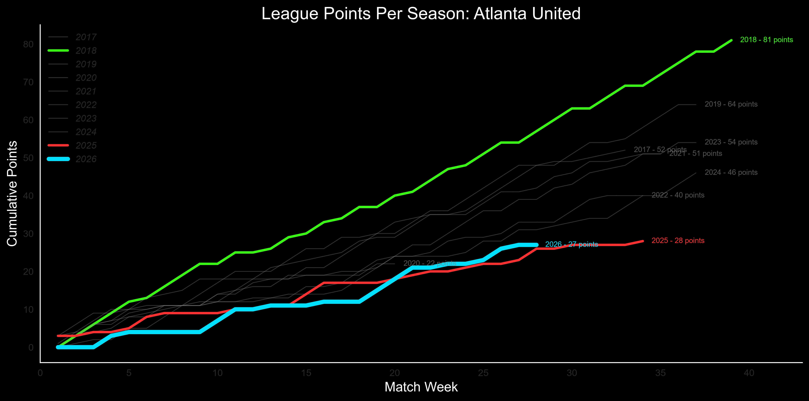
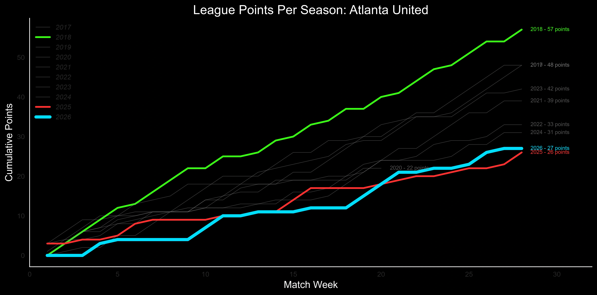

# Points Per Season

Generates charts comparing cumulative points earned across multiple seasons for a soccer team.

Each season is plotted as an individual line, allowing comparisons of team performance at equivalent stages of a season.

The application supports multiple teams, configurable points systems, match filtering, manual season highlighting, and WebP chart output.



## Features

- Compare cumulative points across multiple seasons.
- Support seasons with different numbers of matches.
- Generate full-season and limited-season charts.
- Highlight selected seasons using configurable colors.
- Automatically emphasize the latest season when it is included in the highlights.
- Display other seasons using muted gray lines.
- Support standard and shootout-based points systems.
- Filter matches by competition, round, or other CSV columns.
- Process one team or all configured teams.
- Generate a social-media message using each team's configured signature.
- Export charts in WebP and other supported image formats.

## Project Structure

```text
Soccer_Charts/
├── Points_Per_Season/
│   ├── Points_Per_Season.py
│   ├── Config.toml
│   ├── Config.toml.example
│   └── README.md
├── Processing/
│   ├── Data_Processing.py
│   └── Soccer_Processing.py
├── Graphing/
│   └── Chart_Lines.py
├── Dictionaries/
│   └── Colors/
│       ├── Seasons_ATLUTD.json
│       └── Seasons_ATLUTD2.json
└── Output/
    └── Points_Per_Season/
```

The `Processing` and `Graphing` modules are shared components that may also be used by other applications.

## Configuration

Copy `Config.toml.example` to `Config.toml` in the `Points_Per_Season` directory.

Update the CSV paths to point to your local match data.

The configuration contains four primary areas:

### Teams

Each team has its own configuration under `[Teams.Team_ID]`.

| Setting | Description |
|---|---|
| Name | Display name used in chart titles and console output |
| CSV | Path to the team's match data |
| Points_System | Points calculation system |
| Colors | Path to the team's season highlight JSON |
| Includes | Rules identifying records to include |
| Excludes | Rules identifying records to remove |
| Signature | Text appended to the social-media message |

### Points Systems

**Standard**

- Win: 3 points
- Draw: 1 point
- Loss: 0 points

**Shootout**

Supports the MLS NEXT Pro shootout points system:

- Regulation win: 3 points
- Draw followed by shootout win: 2 points
- Draw followed by shootout loss: 1 point
- Regulation loss: 0 points

The points calculation is handled by `Processing/Soccer_Processing.py`.

### Match Filtering

Filters are configured using `Column=Value` expressions.

For example:

```toml
Includes = [
    "Comp=MLS"
]

Excludes = [
    "Comp=Friendly",
    "Comp=Leagues Cup",
    "Round=Friendly"
]
```

When inclusion rules are supplied, records must match at least one inclusion rule.

Records matching any exclusion rule are removed.

An empty `Includes` list means no inclusion restriction is applied.

### Chart Settings

The `[Chart]` section controls which teams are processed and the chart labels.

```toml
[Chart]
Team = "ALL"
Title = "League Points Per Season: "
X_Label = "Match Week"
Y_Label = "Cumulative Points"
```

Valid team selections include `ATLUTD`, `ATLUTD2`, and `ALL`.

`ALL` processes every configured team that has a CSV defined.

### Chart Styling

The `[Chart.Style]` section controls chart appearance.

| Setting | Description |
|---|---|
| Background_Color | Chart background color |
| Muted_Color | Color assigned to seasons not explicitly highlighted |
| Muted_Opacity | Opacity of non-highlighted seasons |
| Highlight_Opacity | Opacity of highlighted seasons |
| Highlight_Linewidth | Line width for highlighted seasons |
| Current_Linewidth | Line width for the latest season when highlighted |
| Default_Linewidth | Line width for non-highlighted seasons |

Opacity values range from `0.0` (transparent) to `1.0` (fully opaque).

## Season Highlights

Season highlights are configured independently for each team using JSON files in `Dictionaries/Colors/`.

Example: `Seasons_ATLUTD.json`

```json
{
    "2018": "#39FF14",
    "2025": "#FF3030",
    "2026": "#00DFFF"
}
```

Only explicitly listed seasons receive highlighted colors and styling.

All other seasons use the muted color and opacity configured in `Config.toml`.

The latest season is determined automatically from the team's filtered match data. If that season appears in the JSON highlights, it receives the configured `Current_Linewidth`.

This allows the user to choose which historical seasons deserve attention without changing the application code.

## Running the Application

From the `Soccer_Charts` project directory:

```powershell
python Points_Per_Season/Points_Per_Season.py
```

The application will:

1. Load the configuration.
2. Determine which teams to process.
3. Load, deduplicate, and filter the match records.
4. Calculate points and cumulative season totals.
5. Generate full and limited charts.
6. Print the generated file locations.
7. Display the social-media message for each team.

## Generated Charts

For each team, two charts are produced.

**Full chart**

Displays every available match for every season.

**Limited chart**

Truncates longer seasons to the number of matches recorded for the latest season. Shorter seasons retain their available matches.

The latest season is determined separately for each team.

### Output Files

By default, charts are saved under:

```text
Output/
└── Points_Per_Season/
    ├── ATLUTD_Points_Per_Season_Full.webp
    ├── ATLUTD_Points_Per_Season_Limited.webp
    ├── ATLUTD2_Points_Per_Season_Full.webp
    └── ATLUTD2_Points_Per_Season_Limited.webp
```

The output directory and file format are configurable under `[Output]`.

## Social-Media Message

After generating a team's charts, the application prints a message describing the number of matches in its latest season.

Example:

```text
Number of Points Each Season through 28 games
#ATLUTD #MLS
```

The hashtags and other signature text are defined separately for each team.

The application only displays this message. It does not publish to social platforms.

## Match Data

Match data is read from the CSV path configured for each team.

The application uses match dates to determine seasons and chronological order. Match results and the selected points system determine points earned.

The filtering rules require the referenced columns to exist in the CSV.

The application also removes duplicate matches using the Date, Comp, Round, and Opponent fields.

## Notes

- Charts are generated from the available CSV data, not live league standings.
- Match counts depend on the inclusion and exclusion rules.
- Postseason matches may be included if they match the configured filters.
- The latest season is derived from the data rather than a manually configured year.
- Season highlight colors are independent of points calculations.
- Configured team paths should be updated for each installation.

### Example Charts

**Full Season Comparison**


**Limited Season Comparison**


